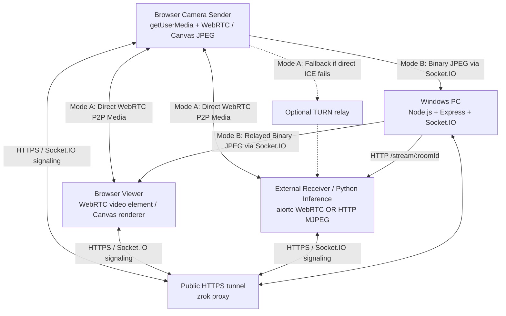
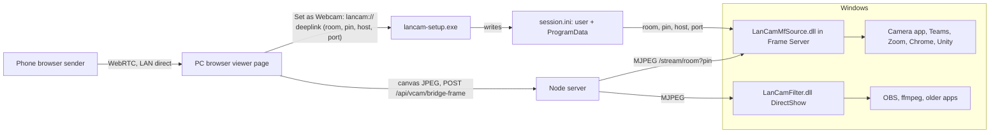

# LAN Camera Streaming — Architecture

## 1. System context

The Windows PC hosts the application. Browsers use it for the sender/viewer UI and signaling. The server does not process or store video in the normal path.



This Node.js repository provides two distinct, selectable media transport modes:
1. **Mode A: WebRTC Mode (Direct/ICE Media)**: Camera video travels directly peer-to-peer between browsers or via TURN relay. The Windows server and zrok tunnel carry signaling only.
2. **Mode B: Experimental zrok-Tunneled Video Mode (Application Relay)**: Camera frames are downscaled via Canvas, binary JPEG encoded, and deliberately routed through the Windows Node.js server to the authorized viewer to test throughput and latency against the zrok free transfer allowance (5 GB daily).

Any external receiving application (such as an external Python `aiortc` client running OpenCV, PyTorch, or YOLO in a separate project) connects via:
1. **WebRTC (`aiortc`)**: Negotiates directly through Socket.IO signaling to receive the camera media track peer-to-peer.
2. **HTTP MJPEG**: Reads standard multipart/x-mixed-replace stream from `/stream/:roomId?pin=...`.

A room supports one sender and several viewers at once (section 11), and the phone camera can also be exposed to Windows applications as a virtual webcam (section 12).

## 2. Components and responsibilities

### 2.1 Node.js application server

- Starts the Express HTTP server and attaches Socket.IO to the same HTTP server.
- Serves the sender and viewer HTML/CSS/JavaScript assets.
- Creates and tracks temporary rooms and peer membership in memory for the MVP.
- Validates room IDs, pairing secrets, membership, and signaling message sender/recipient.
- Relays small WebRTC signaling payloads only; it must not accept or forward raw video frames.
- Removes stale peers and rooms after disconnects and timeouts.
- Does not persist camera content or room secrets to disk.

### 2.2 Sender browser

- Requests camera permission only after a user gesture.
- Calls `navigator.mediaDevices.getUserMedia()` with a video-only constraint for MVP.
- Displays a local preview and stream status.
- Creates an `RTCPeerConnection`, adds the video track, and exchanges SDP/ICE information through Socket.IO.
- Calls `MediaStreamTrack.stop()` and closes the peer connection on Stop, page teardown, or unrecoverable failure.
- Reports actual track settings and connection state for diagnostics.

### 2.3 Viewer browser

- Joins a room using the room ID and secret/PIN.
- Creates an `RTCPeerConnection` and responds to an offer with an answer.
- Adds received tracks to a `MediaStream` and assigns it to the viewer `<video>` element.
- Provides mute/unmute audio controls only if audio is added in a future scope; the MVP is video-only.
- Shows meaningful states such as Waiting for sender, Connecting, Live, Reconnecting, and Disconnected.
- Closes its peer connection and removes listeners when leaving a room.

### 2.4 Socket.IO signaling & Experimental Tunnel Relay

Socket.IO acts as:
1. **Control & Signaling Channel**: Exchanges room join requests, peer notifications, SDP offer/answer, ICE candidates, and lifecycle state.
2. **Experimental Tunnel Relay (Mode B)**: In `tunnel-relay` mode, accepts raw binary JPEG buffers (`tunnel:frame`), validates magic bytes and frame sizes (<=600KB), drops stale frames under backpressure when incoming rate exceeds max FPS, routes directly to the authorized viewer in the room, and records throughput statistics.

Validate every event on the server. A client must not be allowed to send signaling or video payloads to peers outside its authorized room.

### 2.5 zrok Tunnel Provider

`zrok` publishes the local Express application over a secure public HTTPS URL (`https://<hash>.share.zrok.io`).
- In **Mode A**, zrok carries the initial web page delivery and Socket.IO signaling. WebRTC media flows directly peer-to-peer or via TURN.
- In **Mode B**, zrok proxies all web traffic, Socket.IO connections, and binary video frame relays, enabling direct experimentation against zrok's free daily quota (5 GB).

### 2.6 Optional TURN server

TURN is not required for same-LAN WebRTC streaming. Add it if testing shows that direct connectivity fails on restrictive networks. Mode B (tunneled relay) serves as an alternative application-level relay through the Windows server.

### 2.7 Standalone Executable & Embedded Asset System

To allow zero-dependency portable deployment on Windows, the application can be compiled into a single executable binary (`dist/lan-camera-streaming.exe`).
- **Node.js SEA (Single Executable Application)**: Uses official Node 20+ SEA injection with `postject` and `esbuild`.
- **Embedded Asset Registry**: Frontend assets from `src/public` are inlined into `src/server/embedded-assets.js` at build time. Express routes check disk paths first (allowing local customizations) and fall back to in-memory embedded assets when deployed as an isolated `.exe`.
- **CLI & Supervision**: The console executable (`src/server/cli.js`) handles flag parsing, private LAN IP detection, terminal QR code rendering, and automated zrok lifecycle management.


## 3. Routes and pages

| Path | Purpose |
|---|---|
| `/` | Role selection hub (sender / viewer), mobile QR card, protocol guide |
| `/sender` | Camera preview, room creation/join, Start/Stop controls, share links |
| `/viewer` | Room join form, remote video player, "Set as Webcam" and "Download Driver" actions |
| `/health` | Simple server health check; do not return secrets or internal details |
| `/api/config` | ICE servers (STUN, and TURN when configured); never returns the PIN |
| `/api/network-info` | `{ protocol, port }` only, so a page can build a `localhost` viewer link (no LAN IPs: the route is public through a tunnel) |
| `/api/qr?text=` | QR code data URL for share links |
| `/vendor/socket.io.js` | Socket.IO browser client, served by the app so it also works inside the exe |
| `/stream/:roomId?pin=` | MJPEG stream for OpenCV/ffmpeg and the Windows virtual camera (section 4.5) |
| `/snapshot/:roomId?pin=` | One fresh JPEG; asks the sender for a frame if none is recent |
| `POST /api/vcam/bridge-frame?room=` | Viewer page uploads JPEG frames for the virtual camera (section 12) |
| `/download/lan-camera-setup` | The driver installer `lan-camera-setupv<version>.exe` (aliases `/download/lancam-vcam`, `.exe`, `.zip`) |

The public tunnel should expose only the intended app routes. The MVP has no unauthenticated admin dashboard.

## 4. External WebRTC Receiver Signaling Contract (Version 1.0)

This contract defines the exact Socket.IO event protocol for any external client (such as an external Python `aiortc` client, a Unity app, a Go or Rust service) connecting to this Node.js signaling server. It is language-neutral. For how to *use* it (sequence, error handling, the mistakes that cost the most time) read [`receiver-guide.md`](receiver-guide.md); this section is the formal reference.

### 4.1 Connection & Authentication
- **Transport**: Socket.IO client (v4.x compatible over WebSocket/Polling).
- **Endpoint**: Base server URL (e.g., `http://<host>:3000` or `https://<zrok-subdomain>.share.zrok.io`).
- **Namespace**: Default (`/`).
- **Authorization**: Required `pin` (matching server `ACCESS_PIN`, minimum 4 characters).
- **Room ID Format**: `^[a-zA-Z0-9_-]{3,32}$`.
- **ICE configuration**: `GET /api/config` returns `{ "iceServers": [ { "urls": [...] }, { "urls": [...], "username", "credential" } ] }` (STUN, plus TURN when the server has one). A receiver builds its peer connection from it and falls back to public STUN if the request fails. `GET /api/network-info` returns only `{ protocol, port }`.
- **Membership is per socket.** The server removes a socket from its room when it disconnects, so a receiver must emit `room:join` again on **every** `connect` event, including automatic reconnects.
- **Join rate limit.** Five failed `room:join` attempts on one socket block that socket for 30 seconds.

### 4.2 Participant Roles
The server enforces a 1-sender model with support for **multiple concurrent viewers/receivers** per room. A second sender is refused (`Room already has an active sender.`), but multiple viewers (browser tabs, laptops, Python sidecars) can join concurrently and receive peer-to-peer WebRTC feeds from the camera sender via multi-peer mesh. Canonical role identifiers:
- `camera-sender` (or `sender`): captures and publishes camera stream.
- `webrtc-receiver` (or `viewer`): receives the remote camera stream.

### 4.3 Supported Socket.IO Events

#### 1. `room:join` (Client → Server)
Requests room registration and authentication.
```json
{
  "roomId": "room-abc123",
  "role": "webrtc-receiver",
  "pin": "123456",
  "mediaMode": "webrtc"
}
```
`mediaMode` is `"webrtc"` (default) or `"tunnel-relay"`. A room's mode is fixed by whoever created it; joining with the other mode is refused.

**Server Ack Callback Response**:
```json
{
  "success": true,
  "roomId": "room-abc123",
  "role": "viewer",
  "mediaMode": "webrtc",
  "hasPeer": true,
  "peerSocketId": "socket_xyz",
  "peerSocketIds": ["socket_xyz"]
}
```
For a viewer, `peerSocketId` is the sender. For a sender, `peerSocketIds` lists every viewer already in the room and `peerSocketId` is the first of them (see section 11).

If failed:
```json
{
  "success": false,
  "error": "Invalid access PIN"
}
```
Error strings (see [`receiver-guide.md` section 5](receiver-guide.md#5-errors-and-limits) for which can be retried): `Invalid access PIN`; `Invalid Room ID. Must be 3-32 alphanumeric characters.`; `Invalid role. ...`; `Media mode mismatch. This room is configured for "<mode>" mode.`; `Room already has an active sender.`; `Too many failed attempts. Please wait N seconds before retrying.`; `Invalid payload format.`; `Internal server error`.

#### 2. `peer:joined` (Server → Peer)
Emitted to a participant **already in the room** when another joins: the sender is told about each new viewer (`peerId` = that viewer's socket id), and, when a sender joins a room that already has viewers, the **first** viewer is told the sender arrived. A participant that joins second does **not** receive it; it learns who is present from its own join ack (`hasPeer`, `peerSocketId`, and for a sender `peerSocketIds`). The sender creates one offer per viewer, on `peer:joined` or from its ack when it joined second.
```json
{
  "role": "viewer",
  "mediaMode": "webrtc",
  "peerId": "socket_abc"
}
```

#### 3. `webrtc:offer` (Bidirectional: Peer ↔ Server ↔ Peer)
Relays an SDP offer. The sender creates one offer per viewer and names the recipient with `targetId` (the viewer's socket id; section 11). The relayed event carries the id of the socket that sent it:
```json
{
  "sdp": "v=0\r\no=- 1234567 2 IN IP4 127.0.0.1...",
  "type": "offer",
  "senderId": "socket_abc"
}
```
The offer has one video m-line and no audio. A receiver builds a **new** peer connection for every offer. (The shipped sender page also answers an offer it receives, i.e. a receiver-initiated flow, but no test here exercises it.)

#### 4. `webrtc:answer` (Bidirectional: Peer ↔ Server ↔ Peer)
A viewer's answer goes to the sender; the relayed event carries `senderId` = the answering **viewer's** socket id so the sender can match it to the right peer connection:
```json
{
  "sdp": "v=0\r\no=- 7654321 2 IN IP4 127.0.0.1...",
  "type": "answer"
}
```

#### 5. `webrtc:ice-candidate` (Bidirectional: Peer ↔ Server ↔ Peer)
Relays an ICE candidate. From the sender, `targetId` selects one viewer (without it the candidate is broadcast to all viewers); from a viewer it goes to the sender with `senderId` = the viewer's socket id:
```json
{
  "candidate": "candidate:1 1 UDP 2130706431 ...",
  "sdpMid": "0",
  "sdpMLineIndex": 0
}
```
The sender trickles candidates **after** its offer; they can reach a receiver before it has finished applying the offer, so a receiver queues them until the remote description is set. An empty `candidate` string is end-of-candidates. A candidate may use an mDNS `.local` host that not every stack can resolve; a receiver ignores a candidate it cannot add rather than ending the session. A receiver whose WebRTC stack does not trickle (for example `aiortc`) embeds its candidates in the answer SDP and sends none.

#### 6. `stream:state` (Sender → Server → Receiver)
Notifies of explicit stream lifecycle changes:
```json
{
  "state": "live" | "stopped"
}
```

#### 7. `peer:left` (Server → Peer)
Notifies when a counterpart leaves or disconnects. A leaving viewer notifies the sender; a leaving sender notifies every viewer. `peerId` is the socket id that left:
```json
{
  "role": "sender" | "viewer",
  "peerId": "socket_abc"
}
```

#### 8a. `mjpeg:demand` (Server → Sender)
Tells the sender whether any HTTP MJPEG/snapshot consumer is waiting. The sender uploads `mjpeg:frame` buffers only while `active` is `true` (also emitted right after the sender joins if a consumer is already waiting); the server drops frames received without demand.
```json
{
  "active": true
}
```

#### 8b. `tunnel:frame` (Sender → Server → Receiver, relay mode only)
A binary JPEG buffer. The server accepts it only from a sender in a `tunnel-relay` room, rejects anything that is not a JPEG (`0xFF 0xD8` header) or exceeds 600 000 bytes, drops frames beyond 30 per second, and forwards the buffer unchanged to the room's receiver.

#### 8. `room:leave` (Client → Server)
Explicit departure from the room. Triggers cleanup and notifies peer.

#### 9. `room:error` (Server → Client)
Returns safe error notification if an unauthorized or malformed event is sent:
```json
{
  "message": "Unauthorized: Not in a room."
}
```

### 4.4 External Receiver Connection Sequence
1. External client reads `GET /api/config` and builds its ICE configuration.
2. It establishes a Socket.IO connection to `https://<host-or-zrok-url>`.
3. On **every** `connect` it emits `room:join` with `{ roomId, role: "webrtc-receiver", pin, mediaMode: "webrtc" }` and checks the ack.
4. Acknowledged with `hasPeer: true`, or it simply waits (the sender, joining later, sees `hasPeer: true` in its own ack and offers).
5. Sender creates the SDP offer and transmits `webrtc:offer` through Socket.IO.
6. Receiver creates a new peer connection, sets the remote description, applies any queued candidates, generates the SDP answer, and emits `webrtc:answer`.
7. The sender's `webrtc:ice-candidate` events are applied as they arrive (queued before step 6 completes).
8. WebRTC establishes the media path: direct on a LAN, TURN relay if the server has one and direct fails. A zrok tunnel never carries WebRTC media.
9. The remote video track is consumed by the receiver. `peer:left` closes the connection and the receiver waits for a fresh offer.

### 4.5 Optional HTTP MJPEG Ingestion
As an alternative to WebRTC, external applications can read:
```text
GET /stream/:roomId?pin=<accessPin>
```
Response format: `multipart/x-mixed-replace; boundary=--frame`.
Each part is a complete standard JPEG image with its own `Content-Length`. `401` for a missing or wrong PIN. This route does **not** join the room, so it works while a browser viewer is open.

The server writes the delimiter as `--frame` while the header declares `boundary=--frame`; a strictly RFC-conforming parser would expect `----frame`. OpenCV and ffmpeg tolerate it; a hand-written parser should rely on each part's `Content-Length`. Frames flow only while at least one consumer is connected (the server tells the sender through `mjpeg:demand`), and the PIN is part of the URL, so the URL must not be logged. `GET /snapshot/:roomId?pin=<accessPin>` returns a single fresh JPEG.

### 4.6 Writing a receiver
[`receiver-guide.md`](receiver-guide.md) is the practical companion to this section: choosing a transport, the sequence with message examples, the error and retry table, when WebRTC will not connect, a receiver checklist, and a reference integration (a Unity app with a Python sidecar).

## 6. HTTPS and LAN topology

- Camera access requires a secure context in supported browsers. Use a trusted HTTPS origin for the sender page.
- For quick development, run one HTTPS tunnel to the local web server. The public URL is internet-reachable unless the tunnel provider/access configuration restricts it; pairing authorization is still required.
- For deployment restricted to a LAN, use a stable private IP or local DNS name and a certificate trusted by every client device. Installing a local CA on mobile devices requires device-specific steps. The server serves HTTPS directly when `HTTPS_CERT_PATH` and `HTTPS_KEY_PATH` are set; `start.ps1 -LocalOnly` runs with no zrok involvement over plain HTTP (phone uses the Chrome "treat insecure origin as secure" flag) or over HTTPS when the user supplies a certificate; no certificate tooling is bundled.
- Recommended viewer placement: the Windows PC opens `/viewer` on `localhost` (a secure context, no camera needed) so only the phone's page load and signaling use the tunnel; WebRTC media stays on the LAN as a host-to-host UDP path.
- A host firewall rule may be needed for local access. Do not disable the firewall globally.
- Wi-Fi client isolation, guest networks, VPN routing, browser privacy policies, and restrictive NAT can prevent direct media connectivity even when the web page loads.

## 7. Security and privacy requirements

- Use unguessable room identifiers and a secret/PIN; do not treat a public URL as authentication.
- Keep room authorization on the server. Avoid trusting room IDs supplied by a peer without verifying membership.
- Use HTTPS/WSS for the web application and signaling.
- Do not log SDP, ICE candidates, pairing secrets, or sensitive URLs in production logs unless carefully redacted and justified.
- Validate payload types and maximum sizes; rate-limit join/create attempts.
- Expire inactive rooms and remove stale socket memberships.
- Never enable camera capture automatically on page load.
- Stop every acquired media track when the sender stops or leaves.
- Do not record, store, or proxy video in the MVP.
- Do not add router port forwarding as a default setup step.

## 8. Observability and diagnostics

Both sender and viewer clients incorporate a live on-screen diagnostics panel with clipboard copy and clear controls:
- Server health and Socket.IO connected/disconnected state with socket ID;
- Room join state, canonical participant roles, and agreed media transport mode (`webrtc` vs `tunnel-relay`);
- Real-time ICE lifecycle events:
  - Local candidate gathering with human-readable type breakdown (`HOST`, `SRFLX`, `RELAY`), protocol, and IP/mDNS status;
  - Remote candidate arrival logging and early queueing (`pendingRemoteCandidates`);
  - ICE gathering state transitions (`new` → `gathering` → `complete`);
  - Signaling state transitions (`stable` → `have-local-offer` → etc.);
  - Candidate error events (`onicecandidateerror`) detailing errorCode and STUN/TURN host;
  - `RTCPeerConnection.connectionState` and `iceConnectionState`;
- WebRTC active stats polling:
  - Active nominated candidate pair: local candidate type/address vs remote candidate type/address, and RTT (round-trip time in milliseconds);
  - Inbound/outbound frame rate (FPS), dimensions (width x height), and bytes transferred;
- Mode B (Tunnel Relay) diagnostics:
  - Frames sent/received, dropped frames count, average FPS, encode latency in ms, and data consumption rate (MB and projected MB/hr).

Never report `Live` simply because a room was joined. Confirm that a remote track is received and rendered.

## 9. Project layout

```text
lan-camera-streaming/
├── AGENTS.md               # agent rules (read first)
├── docs/                   # project-overview, architecture, roadmap, tasks, decisions, ai_handoff, receiver-guide
├── src/
│   ├── server/             # Express, Socket.IO, rooms, MJPEG streamer, tunnel relay, CLI, embedded-assets (generated)
│   └── public/             # sender/viewer/index pages, css, js modules
├── scripts/                # build-embedded-assets, build-exe, bump-version
├── tests/                  # node:test suites (signaling, rooms, MJPEG, CLI, server routes, path classification)
├── vcam/                   # git submodule: Windows virtual camera driver + Inno Setup installer (own docs/)
├── assets/                 # icon.ico / icon.png
├── dist/                   # build output (git-ignored): exe, driver installer, .env
├── start.ps1               # development supervisor (zrok mode)
├── build.bat               # version bump + vcam driver/installer + exe
├── .env.example            # non-secret configuration template
└── package.json
```

## 10. Failure handling

- **Camera denied/not available**: show a clear message and leave the sender stopped.
- **Room invalid/expired/full**: reject the join with an actionable message.
- **Peer leaves**: clear the remote video and show Disconnected; allow an explicit retry.
- **ICE fails on Same-LAN with zrok**:
  - *Diagnosis*: Same Wi-Fi connections via public tunnel (e.g. Android + Windows) often fail direct WebRTC when:
    1. Android Chrome obfuscates host candidates with mDNS (`<uuid>.local`), which Windows cannot resolve if multicast UDP 5353 is blocked by router AP isolation or Windows Firewall.
    2. STUN server-reflexive (`srflx`) fallback fails because both devices share the router's public WAN IP, and consumer routers lack NAT Loopback / Hairpinning for UDP.
    3. Windows Defender Firewall classifies the Wi-Fi network as "Public" and blocks unsolicited incoming UDP packets.
  - *Update (ADR-015)*: causes 1 and 2 above are unlikely for a host-to-host pair (a camera-permitted sender exposes its real LAN IP and ICE checks work in both directions). The on-screen diagnosis now lists AP/client isolation, Windows Firewall profile and VPN adapters, and the path indicator shows whether the nominated pair is LAN direct.
  - *Mitigation*: Client directs the user to **Mode B (Fallback zrok Tunnel Relay)** as a last resort; it transmits frames through the authenticated server WebSocket, works on any topology, and consumes zrok quota.
- **Server restarts**: all in-memory rooms are lost in the MVP; both peers must create/join a new room.
- **Tunnel URL changes**: clients must reopen the current URL; document this development limitation.

## 11. Multiple viewers per room (ADR-018)

A room has exactly one sender and any number of viewers/receivers. The sender page keeps one `RTCPeerConnection` per viewer (a mesh, not an SFU), so every extra viewer costs the camera device one more video encoder and upload.

| Concern | Behavior |
|---|---|
| Capacity | One sender (`Room already has an active sender.` for a second one). Viewers are unlimited by the server; practical limit is the phone's encode power (about 2-4 viewers). |
| Room state | `RoomManager` keeps `senderSocketId` and `viewerSocketIds: Set`. The room is deleted when the sender and every viewer have left. |
| Join ack | A viewer gets `peerSocketId` = the sender. A sender gets `peerSocketIds` = every viewer already present (and `peerSocketId` = the first one for old clients). |
| `peer:joined` | A new viewer: the sender receives `{ role: "viewer", peerId: <viewer socket id> }` and creates one offer **for that viewer**. A sender joining a room that already has viewers: only the **first** viewer receives `{ role: "sender" }`; the sender offers to every viewer in `peerSocketIds` from its own ack. |
| Offers | The sender must name the recipient: `webrtc:offer` carries `targetId` (the viewer socket id). The server forwards it to that viewer only. An offer with no `targetId` is accepted only while exactly one viewer is present; with two or more the server answers the sender with `room:error` "This sender page is outdated and cannot serve several viewers. Reload the sender page..." and drops it (a sender page loaded before multi-viewer support would otherwise give every offer to the first viewer). |
| Answers and candidates (viewer to sender) | Forwarded to the sender. The relayed event carries `senderId` = the **viewer's** socket id (the name is historical), which the sender uses to find the right peer connection. |
| Candidates (sender to viewer) | `webrtc:ice-candidate` with `targetId` goes to that viewer; without it, it is broadcast to all viewers. |
| `peer:left` | Viewer leaves: the sender receives `{ role: "viewer", peerId }` and closes only that peer connection. Sender leaves: every viewer receives `{ role: "sender", peerId }`. |
| `stream:state`, `tunnel:frame` | Broadcast to every viewer in the room. |
| Media mode | Still one per room, fixed by its creator; every participant must use the same mode. |

Receivers written against the contract need no changes: they still wait for an offer and answer it; only the sender side changed.

## 12. Windows virtual webcam (ADR-021, ADR-022, ADR-023)

Goal: a phone camera that appears as a normal camera ("LAN Phone Camera") to Windows applications. The driver lives in its own repository, mounted as the git submodule `vcam/` (documented in `vcam/docs/`).



- **Frame path (as built).** The viewer page that is already receiving the WebRTC stream draws the video to a canvas at about 30 FPS and POSTs each JPEG to `POST /api/vcam/bridge-frame?room=<id>`. The server hands the JPEG to the MJPEG streamer, which serves it at `/stream/<roomId>?pin=<pin>`. Both driver components read that MJPEG stream over loopback HTTP. While the viewer is pumping frames (a POST within the last 3 seconds), the server does **not** ask the phone to upload its own MJPEG frames (`mjpeg:demand` is suppressed), so the phone sends WebRTC only. If no viewer pumps, the driver's connection to `/stream/...` triggers `mjpeg:demand` and the phone uploads MJPEG instead.
- **The shared-memory design in ADR-022 is wired.** `vcam-shm-bridge.js` maintains a persistent TCP bridge client to `lancam-setup.exe --bridge` on 127.0.0.1:7779, writing directly to `Local\LanCamSharedMemory_Video`. The DirectShow filter prioritizes shared memory before falling back to loopback HTTP.
- **Two cameras, two stacks.** The DirectShow filter is seen by DirectShow clients (OBS, ffmpeg, Chrome/Electron apps). The Windows Camera app, Teams and other Media Foundation / WinRT consumers only see Media Foundation or kernel-streaming cameras, so `LanCamMfSource.dll` registers a Media Foundation virtual camera (Windows 11, `MFCreateVirtualCamera`, system lifetime). Both read the same MJPEG stream.
- **Session.** `Set as Webcam` runs `lancam://stream?room=..&pin=..&host=..&port=..`; `lancam-setup.exe` (as the normal user, no UAC) stores it in `%LOCALAPPDATA%/LanCamera/session.ini` for the DirectShow filter and `%ProgramData%/LanCamera/session.ini` for the Frame Server (which runs as LocalService and cannot read the user's profile).
- **Output.** Both cameras deliver 1280x720 at 30 FPS; incoming frames of any size or orientation are letterboxed (DirectShow: RGB24 bottom-up; Media Foundation: NV12).
- **Install and download.** The driver ships as one Inno Setup installer, `dist/lan-camera-setupv<version>.exe`, built by `vcam/build.bat` (called from the root `build.bat`). The server serves it at `/download/lan-camera-setup` from disk (next to the exe, `dist/`, or the working directory) or from the copy embedded in the exe at build time. The viewer's "Download Driver" link starts the download through a hidden iframe so the page never navigates away from a live stream.
- **Diagnostics.** `%ProgramData%/LanCamera/setup.log` (installer, HRESULTs) and `mfsource.log` (the Media Foundation source inside the Frame Server).

## 13. Build and distribution

- `npm start` / `npm run dev`: source server (`src/server/index.js`). `npm run cli -- --local|--zrok`: console app (`src/server/cli.js`). `start.ps1`: development supervisor for zrok mode.
- `build.bat` (repo root): bumps the patch version, builds the vcam driver and installer (`vcam/build.bat`), then runs `npm run build:exe`.
- `npm run build:exe`: embeds `src/public`, the Socket.IO browser client (`/vendor/socket.io.js`) and the newest driver installer into `src/server/embedded-assets.js`, bundles with esbuild, and produces the Node SEA executable `dist/lan-camera-streaming.exe` with icon and version resources.
- `postinstall` regenerates the git-ignored `embedded-assets.js`, so a fresh clone can start.
- Outputs in `dist/` (git-ignored): `lan-camera-streaming.exe`, `lan-camera-setupv<version>.exe`, `.env`.
 
## 14. Embedded RTSP 1.0 IP-Camera Server (`src/server/rtsp-server.js`)

Implements zero-dependency native RTSP 1.0 (RFC 2326) and RTP JPEG (RFC 2435) streaming over TCP:
- Listens on `rtsp://<host>:8554/live/<roomId>`.
- Supports standard `OPTIONS`, `DESCRIBE`, `SETUP`, `PLAY`, `TEARDOWN` handshakes.
- Streams interleaved TCP RTP packets (`$`, channel 0) to standard surveillance software (VLC, OBS Media Source, ffmpeg, Milestone, Synology).

## 15. Native Unity Integration (`unity-package/`)

A dedicated Unity Package Manager (UPM) package (`com.vcam.lancamera`):
- `LanCameraReceiver`: High-performance MonoBehaviour streaming multipart JPEGs directly into reusable `Texture2D` instances via `ImageConversion.LoadImage` without GC allocations.
- Supports binding to UI `RawImage` or 3D material `Renderer`.
- Strictly compliant with `AGENTS.md`: explicit typing, no `var`, no `new()`, K&R braces, full property bodies.

## 16. Windows System Tray Companion & Auto-Start

- `scripts/lan-camera-tray.ps1`: Docks LAN Camera into the Windows Notification Area with quick links to local viewer, phone sender, and RTSP stream info.
- `scripts/register-autostart.ps1`: Configures `HKCU:\Software\Microsoft\Windows\CurrentVersion\Run` for auto-boot with `-Enable` and `-Disable` flags.

